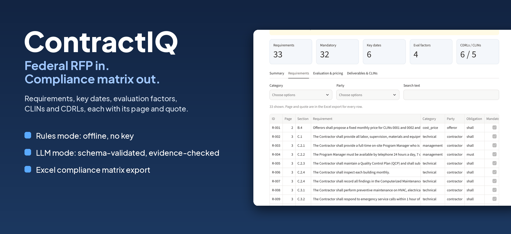
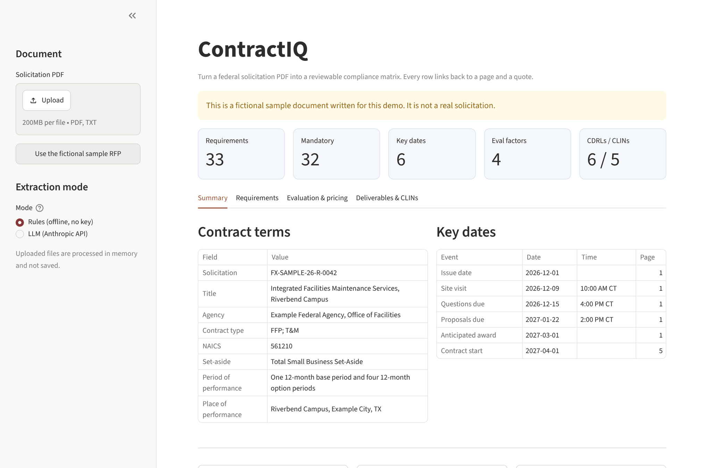
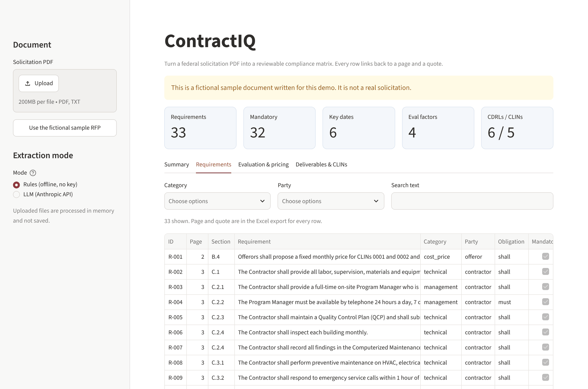
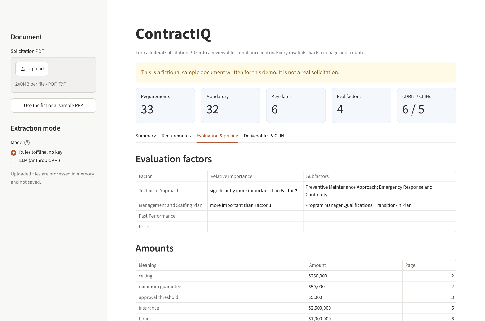
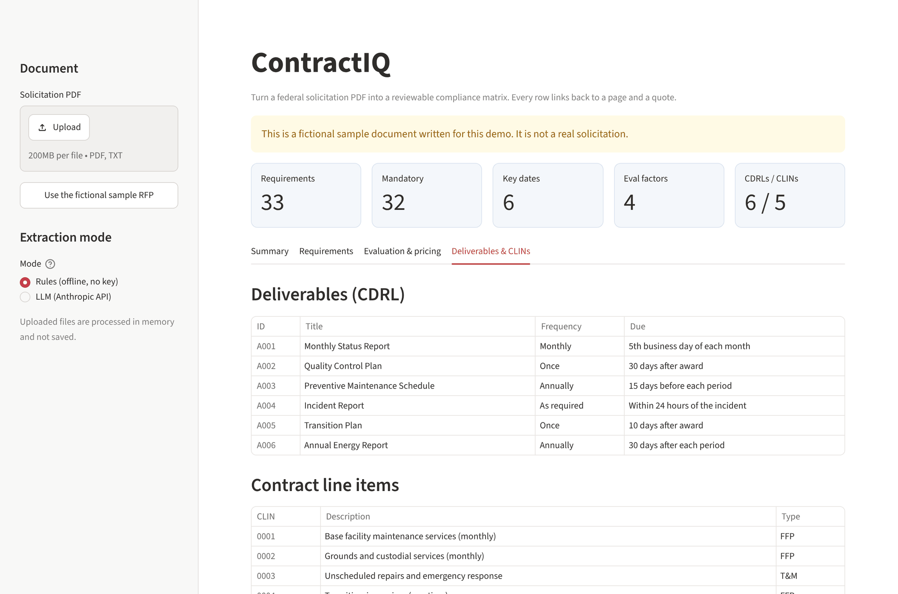
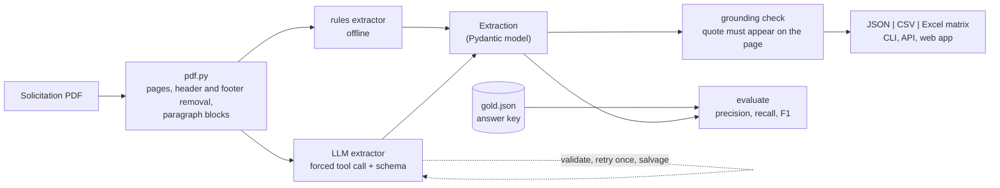

<p align="center">
  
</p>

<p align="center">
  <a href="https://github.com/bvskrishna3137/contractiq/actions/workflows/ci.yml"></a>
  
  
  
  <a href="LICENSE"></a>
</p>

# ContractIQ

Turn a federal solicitation PDF into a **reviewable compliance matrix**: every "shall / must" requirement, the key dates, evaluation factors, contract line items (CLINs) and deliverables (CDRLs), each with **the page and the exact quote** it came from.

I work with contract and facilities data, and reading a 100-page RFP to build a compliance checklist is slow, repetitive and easy to get wrong. ContractIQ does the first pass so a person can spend their time reviewing instead of retyping.

> **The sample document is fictional.** Real solicitations are not bundled. Everything in `samples/` (agency, numbers, dates, text) was invented for this project, and every page of the sample PDF says so.

## Highlights

- **Two modes, one output.** *Rules* mode runs offline with no account or key. *LLM* mode uses the Anthropic API for what regular expressions cannot do (requirements without "shall", messy layouts). Both return the same validated structure.
- **Evidence for every row.** Each item carries a verbatim quote and a page number. A **grounding check** confirms the quote really appears in the document; if an LLM invents text, the item is flagged `grounded = false` instead of silently trusted.
- **Excel compliance matrix.** The workbook opens ready to use: requirement, section, page, category, party, mandatory, plus blank *Proposal reference*, *Owner* and *Status* (dropdown) columns for the proposal team.
- **Measured, not claimed.** A hand-labelled answer key and an `evaluate` command report precision, recall and F1, so changes can be compared with numbers. See [Results](#results-and-what-they-do-not-prove).
- **Tested without a key.** 78 tests, including the whole LLM path against a fake client (retry on invalid output, salvage, truncation, partial failure). CI runs without any secret.

## Screenshots

All screenshots use the fictional sample document.

<table>
  <tr>
    <td align="center"><br><sub><b>Summary</b><br>contract terms and key dates</sub></td>
    <td align="center"><br><sub><b>Requirements</b><br>filter by category, party, text</sub></td>
  </tr>
  <tr>
    <td align="center"><br><sub><b>Evaluation &amp; pricing</b><br>factors, subfactors, amounts</sub></td>
    <td align="center"><br><sub><b>Deliverables &amp; CLINs</b><br>CDRL table and line items</sub></td>
  </tr>
</table>

## Try it in a minute

You need Python 3.10 or newer. No API key is needed for the first run.

```bash
git clone https://github.com/bvskrishna3137/contractiq.git
cd contractiq
python -m venv .venv && source .venv/bin/activate      # Windows: .venv\Scripts\activate
pip install -e ".[app,dev]"

contractiq extract samples/fictional_rfp.pdf           # writes JSON, CSV and Excel to ./output
contractiq evaluate samples/fictional_rfp.pdf --gold samples/gold.json
streamlit run app/streamlit_app.py                     # the web app
```

Ready-made output for the sample is in [`samples/example_output/`](samples/example_output/), so you can look at the Excel file without installing anything.

### LLM mode (optional)

```bash
pip install -e ".[llm]"
cp .env.example .env            # then put your key in .env (git-ignored)
contractiq extract my_rfp.pdf --mode llm --dry-run   # shows requests and size, sends nothing
contractiq extract my_rfp.pdf --mode llm
contractiq evaluate samples/fictional_rfp.pdf --gold samples/gold.json --mode llm   # measure it yourself
```

> **Privacy:** rules mode never leaves your machine. LLM mode sends the document text to the model provider, so only use it with documents you are allowed to share. Do not commit real solicitations; `.gitignore` blocks every PDF except the fictional sample.

### HTTP API

```bash
pip install -e ".[app]"
uvicorn contractiq.api:app --port 8000        # interactive docs at http://127.0.0.1:8000/docs
curl -F file=@samples/fictional_rfp.pdf http://127.0.0.1:8000/extract
```

## What it extracts

| Field | Examples from the sample |
|---|---|
| **Requirements** | sentence, section (`C.3.2`), page, category, who must act, shall/must/will/should, mandatory or not |
| **Key dates** | proposals due, questions due, site visit, award, start (ISO date plus the time as written) |
| **Evaluation factors** | factor, subfactors, stated relative importance |
| **Contract terms** | solicitation number, agency, contract type (FFP, T&M...), NAICS, set-aside, period and place of performance |
| **Amounts** | ceiling, not-to-exceed, minimum guarantee, approval threshold, insurance, bond |
| **CLINs and CDRLs** | line items with pricing type; deliverables with frequency and due date |

## How it works



- **One schema.** Every extractor returns the same Pydantic `Extraction`, so exports, the API and the app do not care which mode produced it.
- **LLM mode uses a forced tool call.** The tool's input schema is generated from the same models, so the reply is data, not prose. Invalid output gets one retry with the error message; if it still fails, the valid items are kept and the dropped ones are counted in `warnings`.
- **Grounding.** The quote check ignores case, spacing and punctuation, corrects an off-by-one page number, and handles a quote that runs over a page break.

More detail: [docs/ARCHITECTURE.md](docs/ARCHITECTURE.md).

## Results, and what they do not prove

Rules mode on the fictional sample, scored against the hand-written answer key (`contractiq evaluate`):

| Collection | Expected | Found | Correct | Precision | Recall | F1 |
|---|---:|---:|---:|---:|---:|---:|
| Requirements | 35 | 33 | 32 | 0.970 | 0.914 | 0.941 |
| Key dates | 6 | 6 | 6 | 1.000 | 1.000 | 1.000 |
| Amounts | 5 | 5 | 5 | 1.000 | 1.000 | 1.000 |
| CLINs | 5 | 5 | 5 | 1.000 | 1.000 | 1.000 |
| CDRLs | 6 | 6 | 6 | 1.000 | 1.000 | 1.000 |
| Evaluation factors | 4 | 4 | 4 | 1.000 | 1.000 | 1.000 |
| **Overall** | 61 | 59 | 58 | **0.983** | **0.951** | **0.967** |

Contract terms: 8 of 8 fields. Of the matched requirements, party and obligation were right every time and category 91% of the time.

**Read this before quoting these numbers.** The sample was written by me, with clean, consistent formatting, so the offline baseline does well on it. It is a **regression test** (it fails if a change makes things worse), **not a benchmark** of real-world accuracy. Real solicitations are messier. The three misses are the interesting part: a prohibition with no modal verb, a condition phrased as "is a condition of site access", and a "will" sentence with no named actor. Those are exactly where LLM mode is meant to help.

I have **not** measured LLM mode against a real model: the tests use a fake client, and the numbers above are for rules mode only. `contractiq evaluate --mode llm` lets anyone measure it with their own key. Details and the limits of the method: [docs/EVALUATION.md](docs/EVALUATION.md).

## Decisions I made

| Decision | Why |
|---|---|
| Rules mode is the default, and it is a real baseline | Works offline, free, instant, explainable. It also gives LLM mode something honest to be measured against. |
| Every item needs a quote and a page | A compliance matrix is only useful if a reviewer can check a row in seconds. |
| A grounding check on LLM output | Models can invent plausible text. An unverifiable quote is flagged, not trusted. |
| A forced tool call with a schema generated from the models | One source of truth for the data shape; no parsing of free text. |
| Salvage invalid items instead of failing the whole document | One malformed row should not throw away 100 good ones, and the loss is reported. |
| Excel output with blank Owner / Status columns | The matrix is a working document for a proposal team, not just a report. |
| Fictional sample with an answer key built from the same source | The PDF and the key cannot drift apart, and the key's page numbers are read back from the PDF. |
| `--dry-run` for LLM mode | See how many requests a document needs before spending anything. |

## Limitations

- **Text PDFs only.** Scanned PDFs have no text to read; ContractIQ warns instead of guessing. Run OCR first (for example `ocrmypdf`).
- **Layout heuristics.** Rules mode expects paragraph numbers like `C.3.2` and labelled cover fields. Unusual layouts, multi-column pages and complex tables will lose items.
- **Rules mode misses requirements written without a modal verb** and files some categories by keyword, so a few are wrong.
- **Not legal or bid advice.** It is a first pass. Read the source before you bid.

## Tests

```bash
pip install -e ".[llm,app,dev]"
python -m pytest -q          # 78 tests, a few seconds, no API key or network needed
```

They cover the reader, every rule, the LLM path with a fake client, scoring, exports, the CLI, the API, a regression floor on the sample, regeneration of the sample and answer key, and **repo hygiene**: a test fails if an API key, a `.env` file or any PDF other than the fictional sample is committed. GitHub Actions runs everything on Python 3.10, 3.12 and 3.13.

## Project layout

```
contractiq/
├── src/contractiq/
│   ├── schema.py            data model (what is extracted, what the LLM returns)
│   ├── pdf.py               pages, header/footer removal, paragraph blocks
│   ├── extractors/rules.py  offline extractor
│   ├── extractors/llm.py    Anthropic tool-use extractor
│   ├── grounding.py         quote-in-document check
│   ├── pipeline.py          file in, validated Extraction out
│   ├── evaluate.py          precision / recall / F1 against an answer key
│   ├── export.py            JSON, CSV, Excel compliance matrix
│   ├── cli.py, api.py       command line and FastAPI
├── app/streamlit_app.py     web app
├── samples/                 fictional RFP, answer key, example output
├── tools/make_sample_rfp.py builds the PDF and answer key from one source
├── tests/                   78 tests
├── docs/                    architecture, evaluation, screenshots
└── .github/workflows/       CI
```

## Built with

Designed and directed by me, and built with help from AI tools (Claude). I chose the scope, the evidence-first design and the honesty rules (what is measured, what is not); the tests, the answer key and the screenshots in this repo are reproducible with the scripts in `tools/` and the commands above.

## License

MIT. See [LICENSE](LICENSE).

---

<sub>Built by Venkata Sai Krishna Baggu · [github.com/bvskrishna3137](https://github.com/bvskrishna3137)</sub>
