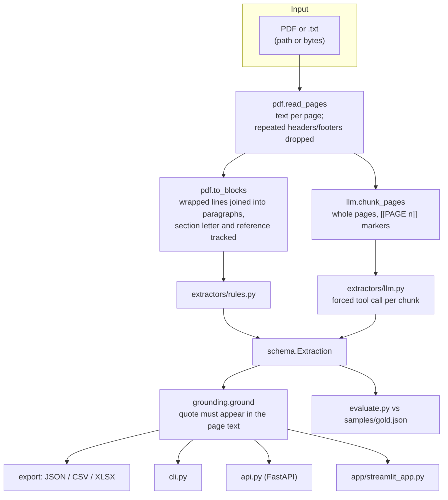
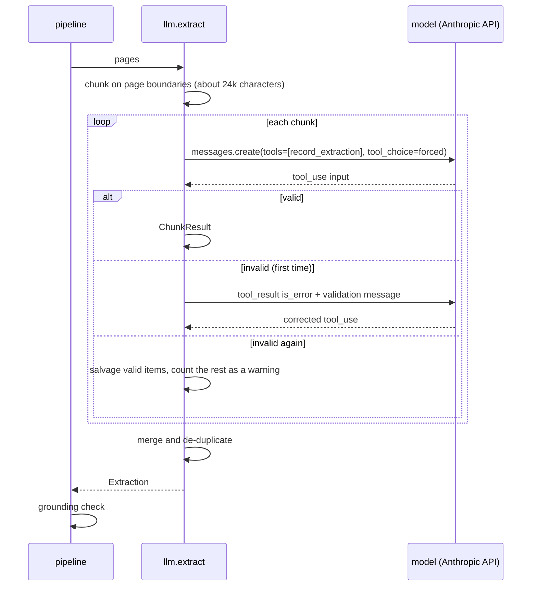

# Architecture

ContractIQ is a small pipeline with one data model in the middle. Everything that reads a document produces an `Extraction`; everything that uses the result consumes one.

## Overview

## The data model (`schema.py`)

- **`Extraction`** holds `metadata`, `terms` (plus `amounts`), `key_dates`, `requirements`, `evaluation_factors`, `deliverables`, `clins` and `warnings`.
- Every item inherits `page`, `evidence` and `grounded`. These three fields are what make a row reviewable.
- A second family of models (`RequirementIn`, `KeyDateIn`, ... `ChunkResult`) describes **what the LLM returns for one chunk**. They are separate on purpose: the model is never asked for ids or bookkeeping, and the tool schema stays small. `llm.tool_definition()` inlines the JSON schema (no `$ref`) so it works as a tool input schema.

## Reading the document (`pdf.py`)

1. `pdfplumber` extracts text per page.
2. **Header/footer removal:** among the first and last two lines of each page, any line that repeats (after replacing digits with `#`) on at least 60% of pages is dropped. This removes banners and "Page 3" without a list of known strings.
3. **Blocks:** lines are joined into logical paragraphs. A new block starts at a paragraph reference (`C.3.2`), a `SECTION X` heading, a `CLIN`, `Factor`, `Subfactor` or CDRL row, or a labelled field (`NAICS Code: ...`). One-line items are not continued by a line that starts with a capital letter, so a heading is not glued to the field above it. A paragraph that runs onto the next page stays whole and is credited to the page where it starts.

## Rules extractor (`extractors/rules.py`)

| Item | Method |
|---|---|
| Requirements | split blocks into sentences; keep those with `shall / must / will / should / required to`. `will` is kept only when a Contractor, Offeror, Vendor or Government is named before it, because "Proposals will be evaluated..." describes the Government, not a duty |
| Party | nearest named actor before the modal verb; otherwise a default from the section letter (C, F, H: contractor; L, M: offeror) |
| Category | keyword rules (insurance, background check, CDRL, price...) then a section default |
| Dates | three formats (`January 22, 2027`, `22 January 2027`, `04/01/2027`); label chosen by keywords near the date; invalid dates such as Feb 30 are ignored; duplicates merged |
| Amounts | `$` figures including "million"; label from nearby words |
| CLIN / CDRL / factors | line patterns; CDRL ids mentioned only in prose are still recorded |

Known weaknesses are documented in [EVALUATION.md](EVALUATION.md) and covered by tests.

## LLM extractor (`extractors/llm.py`)

- **Forced tool use** (`tool_choice = {"type": "tool", "name": "record_extraction"}`) means the answer is structured data.
- **Failure handling:** a request that errors adds a warning and the other chunks still count; only if *every* request fails does the run raise. A reply cut off at the output limit, or one that skips the tool, is reported.
- **Injectable client:** `extract(..., client=...)` accepts anything with `.messages.create`. That is how the tests run the entire path with no network.
- **Prompt:** the system prompt tells the model to copy quotes verbatim, use the page from the nearest marker, include prohibitions written without a modal verb, and skip statements that only describe how the Government will evaluate.

## Grounding (`grounding.py`)

For each item, the quote is compared with the page text after removing everything except letters and digits and lowercasing. Found on the stated page: good. Found elsewhere: the page number is corrected. Found across a page break: accepted. Not found anywhere: `grounded = false`, counted in `warnings`, and shown in the exports.

## Interfaces

| Interface | Notes |
|---|---|
| `contractiq extract / evaluate` | `--mode`, `--model`, `--out`, `--format`, `--dry-run` |
| `api.py` | `/health`, `/extract`, `/extract.xlsx`, `/sample`; 25 MB limit; 400 for a bad mode or missing key, 422 for an unreadable file |
| `app/streamlit_app.py` | upload or sample; filter requirements; download Excel / CSV / JSON |

## Tooling

| File | Purpose |
|---|---|
| `tools/make_sample_rfp.py` | builds the fictional PDF and `gold.json` from one structured source; page numbers in the key are read back from the PDF, and it fails if a quote is missing |
| `tests/` | 78 tests; `FakeClient` in `conftest.py` stands in for the API |
| `.github/workflows/ci.yml` | tests on Python 3.10, 3.12, 3.13, plus the baseline evaluation |
